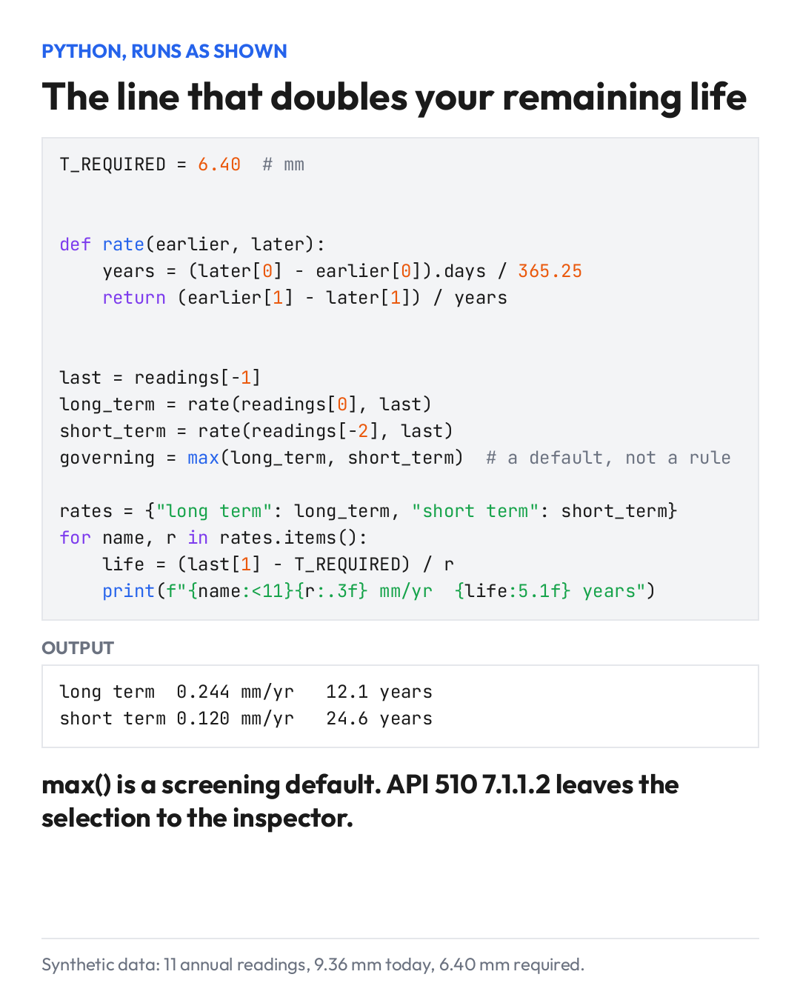

# The Line That Doubles Your Remaining Life

Tuesday 2026-11-10

12.1 years or 24.6 years. Same wall, same 11 readings.

The only thing that changes between those two numbers is which corrosion rate you trust. Long term comes out at 0.244 mm/yr. Short term, from the last interval alone, is 0.120.

In code, that choice is one visible line: governing = max(long_term, short_term).

I went back and forth on that line. With thousands of CMLs you need a default, and the larger rate is the conservative place to start a screening. If the short term rate is low because a process change really did slow the corrosion, max() keeps you on the old rate and you inspect early. Annoying, but safe. If it is low because of one noisy UT reading, max() keeps you from believing it.

It doesn't bound everything, though. Neither rate sees an acceleration that hasn't reached the readings yet.

The code can't tell those cases apart. API 510 7.1.1.2 asks the inspector to weigh things a CSV doesn't hold: process changes, scale, episodic events.

A default can live in code. The selection stays with a person.

What do you check first when a short term rate suddenly drops to half of the long term rate?

## Note

The code on the image runs as shown. The readings are synthetic: a steady rate plus measurement scatter, 11 annual readings, 6.40 mm required thickness.

24.6 uses the unrounded short term rate.
