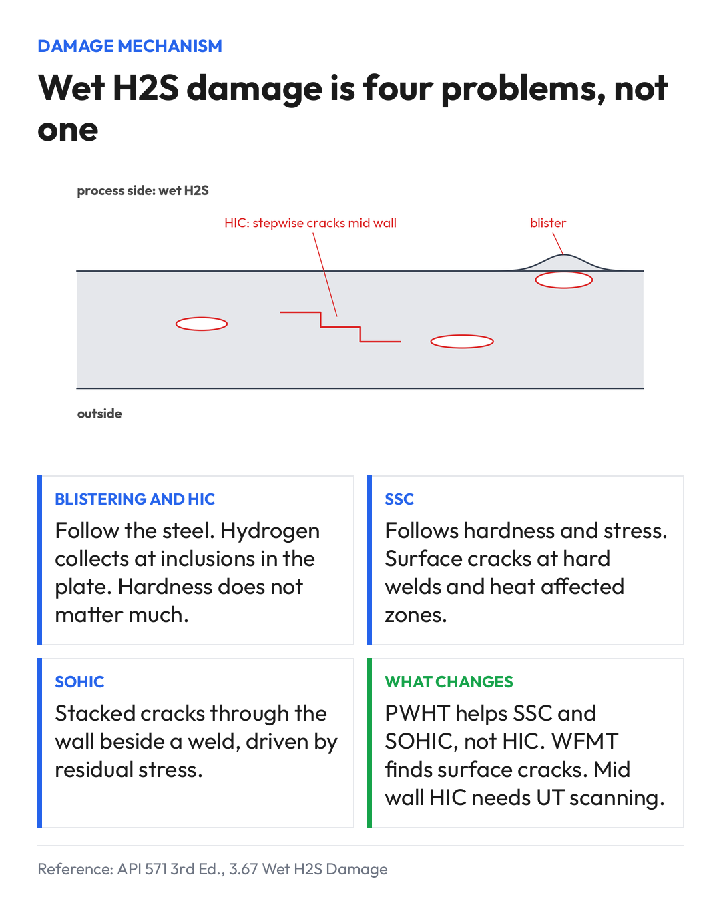

# Wet H2S Damage Is Four Problems, Not One

Wednesday 2026-11-11

"Wet H2S damage" on an inspection plan tells the inspector almost nothing.

API 571 groups four different things under that heading: blistering, HIC, SOHIC and sulfide stress cracking. They share a cause, hydrogen charging of carbon steel in wet sour service. The source matters, and API 571 3.67.1 is explicit about it: "Blistering only results from hydrogen generated by corrosion, not from hydrogen gas in the process stream." They do not share a location, a driver, or an inspection method.

Blistering and HIC follow the steel. Hydrogen collects at inclusions and laminations in the plate, so plate cleanliness matters far more than the weld procedure. Hardness has little to do with it.

SSC follows hardness and stress. It shows up at hard welds and heat affected zones, and it is surface breaking.

SOHIC sits between the two: stacked small cracks through the wall, usually next to a weld, driven by residual stress.

That split decides the work. PWHT lowers residual stress and hardness, which helps with SSC and SOHIC. It does nothing for a dirty plate that blisters. Wet fluorescent magnetic particle testing finds surface cracks at welds. It will not see HIC growing mid wall, where you need UT scanning of the plate.

So a plan that says "wet H2S: WFMT at welds" covers one of the four, maybe two.

I would rather see the four listed separately per vessel, each with its own susceptibility call and method. It takes ten more minutes and it changes what gets inspected.

How does your program split wet H2S damage in the inspection plan?

## Requirements quoted

> "Blistering only results from hydrogen generated by corrosion, not from hydrogen gas in the process stream."
>
> API 571, 3.67.1

## Note

Reference: API 571, 3rd Edition (2020), 3.67 Wet H2S Damage (Blistering/HIC/SOHIC/SSC). For refinery weld hardness control in sour service, the governing document is NACE MR0103.
