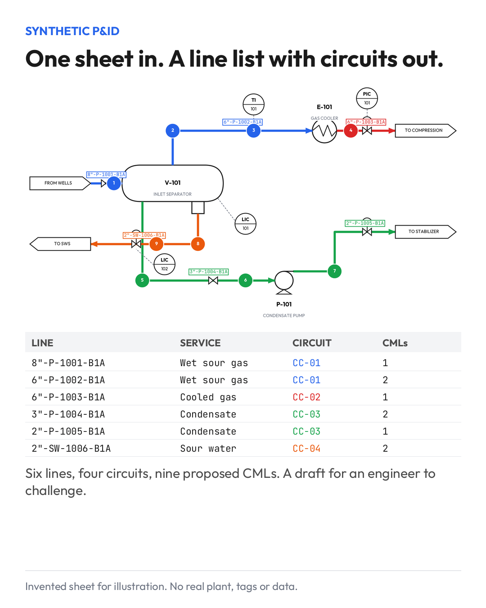

# One P&ID Sheet In, a Line List Out

Thursday 2026-11-12

Most piping integrity programs start with somebody retyping a P&ID into a spreadsheet.

Line number, size, service, spec. Sheet after sheet. Then a second pass to group lines into corrosion circuits, and a third to place CMLs. On a mid-size unit that is weeks of work before any engineering judgment has been applied, and every retyped tag is a chance to get one character wrong.

I have been automating that first pass. The image is an invented sheet, small on purpose: one separator, a cooler, a pump. The drawing goes in. What comes out is the line list, each line assigned to a circuit by service and material, and a first proposal of CML positions.

Six lines, four circuits, nine CMLs on this one. A real unit has hundreds of sheets, which is where it starts to matter.

Two things I would stress. The output is a draft for an engineer to challenge, and the circuit boundaries are the part that gets challenged most. A change of phase, a mix point or an injection point can split a line that looks continuous on paper. And the extraction is only as good as the drawing. An as-built that was never updated gives you a very tidy list of the wrong plant.

The time saved is real, but the bigger gain is consistency. The same rule applied to every sheet, and a record of why each line landed in its circuit.

Where does your piping line list come from today, and who keeps it aligned with the P&IDs?

## Note

The sheet is invented for illustration: no real plant, tags or data. CML monitoring for piping sits in API 570 5.6.
